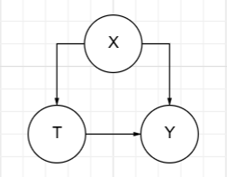

**МИНИСТЕРСТВО НАУКИ И ВЫСШЕГО ОБРАЗОВАНИЯ**

**РОССИЙСКОЙ ФЕДЕРАЦИИ**

**ФЕДЕРАЛЬНОЕ ГОСУДАРСТВЕННОЕ АВТОНОМНОЕ ОБРАЗОВАТЕЛЬНОЕ**

**УЧРЕЖДЕНИЕ ВЫСШЕГО ОБРАЗОВАНИЯ**

**«МОСКОВСКИЙ АВИАЦИОННЫЙ ИНСТИТУТ**

(национальный исследовательский университет)»

> **УТВЕРЖДАЮ**
>
> Директор Дирекции
>
> Института №8 \_\_\_\_\_\_\_\_\_ Крылов С.С.
>
> (подпись) (инициалы, фамилия)

\_\_\_\_\_ \_\_\_\_\_\_\_\_\_\_\_ 20 г.

ОТЧЕТ

О НАУЧНО-ИССЛЕДОВАТЕЛЬСКОЙ РАБОТЕ

по теме:

Исследование и моделирование причинно-следственных связей в больших транзакционных данных электронной коммерции для оптимизации принятия решений

| Научный руководитель |     |              |
|----------------------|-----|--------------|
| Исполнитель          |     | А.С. Лубягин |

Москва 2026

**РЕФЕРАТ**

Отчет 15 с., 2 рис., 8 источников.

ПРИЧИННО-СЛЕДСТВЕННЫЙ ВЫВОД, ЭЛЕКТРОННАЯ КОММЕРЦИЯ, БОЛЬШИЕ ДАННЫЕ, UPLIFT-МОДЕЛИРОВАНИЕ, X-LEARNER, LIGHTGBM, КОНФАУНДЕРЫ, КОНТРФАКТИЧЕСКИЙ АНАЛИЗ.

Объектом исследования являются большие транзакционные данные, логи программ лояльности и кликстрима платформ электронной коммерции.

Предметом исследования выступают методы, алгоритмы, математические модели причинно-следственного вывод и программная архитектура интеллектуальных систем минимизации смещения оценок.

Цель работы – разработка и программная реализация масштабируемого ИТ-конвейера причинно-следственного анализа больших данных e-commerce.

Методы исследования и стек технологий. Работа базируется на математическом аппарате потенциальных исходов Рубина и do-исчислении Джуды Перла. Программный комплекс реализован на языке *Python 3.13* с привлечением специализированных библиотек причинно-следственного ИИ *DoWhy* и *EconML* \[4\]. В качестве базового вычислительного движка интегрирован фреймворк градиентного бустинга *LightGBM*, адаптированный под обработку разреженных Big Data матриц.

Полученные результаты и их новизна. Научная новизна работы заключается в разработке гибридного подхода к Uplift-моделированию, сочетающего явное графовое отсечение конфаундеров по критерию бэкдора и контрфактическую аппроксимацию на базе алгоритма *X-Learner*. Предложенная архитектура позволяет эффективно использовать информацию из избыточной контрольной группы для стабилизации предсказаний на дефицитной целевой выборке, предотвращая переобучение стандартного ML.

Практическая значимость и область применения. Результаты работы имеют прямую применимость в сфере электронной коммерции, ритейла и продуктовой аналитики.

# **СОДЕРЖАНИЕ**

[ВВЕДЕНИЕ [4](#введение)](#введение)

[1 Методы и ИТ-архитектура [8](#методы-и-ит-архитектура)](#методы-и-ит-архитектура)

[1.1 Слой хранения данных и первичного ETL [8](#слой-хранения-данных-и-первичного-etl)](#слой-хранения-данных-и-первичного-etl)

[1.2 Слой причинно-следственного анализа (DoWhy) [8](#слой-причинно-следственного-анализа-dowhy)](#слой-причинно-следственного-анализа-dowhy)

[1.3 Вычислительный ML-слой (EconML + LightGBM) [10](#вычислительный-ml-слой-econml-lightgbm)](#вычислительный-ml-слой-econml-lightgbm)

[1.4 Аналитический слой и бизнес-логика (Streamlit BI) [10](#аналитический-слой-и-бизнес-логика-streamlit-bi)](#аналитический-слой-и-бизнес-логика-streamlit-bi)

[2 Предварительные результаты [11](#предварительные-результаты)](#предварительные-результаты)

[3 План дальнейших работ [13](#план-дальнейших-работ)](#план-дальнейших-работ)

[ЗАКЛЮЧЕНИЕ [14](#заключение)](#заключение)

[СПИСОК ИСПОЛЬЗОВАННЫХ ИСТОЧНИКОВ [15](#список-использованных-источников)](#список-использованных-источников)

# **ВВЕДЕНИЕ**

Актуальность темы в современных условиях глобальной цифровизации ритейла и стремительного масштабирования e-commerce платформ объемы генерируемых логов пользовательского кликстрима, транзакционной активности и маркетинговых метрик достигли масштабов больших данных (Big Data). В этой высококонкурентной среде критически важным бизнес-процессом становится точечное управление лояльностью потребителей и оптимизация распределения бюджетов на проведение промо-акций. Ежедневно алгоритмы генерируют миллионы предложений, включая индивидуальные скидочные купоны и промокоды.

Однако традиционные аналитические методы и классические предикативные модели машинного обучения (Supervised Learning), развернутые на базе градиентного бустинга или глубоких нейронных сетей, обладают фундаментальным математическим ограничением. Они фиксируют лишь поверхностные статистические ассоциации и корреляции, полностью игнорируя причинно-следственные связи (Causal Relationships). На практике это приводит к серьезным управленческим ошибкам. Например, стандартный ИИ-классификатор фиксирует высокую вероятность покупки у наиболее активных пользователей и рекомендует направить им купоны. В реальности эти пользователи (называемые в эконометрике «органическими покупателями») совершили бы транзакцию и по полной стоимости без какого-либо дополнительного стимула. Игнорирование этого фактора ведет к каннибализации маржи ритейлера, снижению чистой прибыли и неэффективному сжиганию маркетинговых бюджетов.

По состоянию на 2026 год мировой рынок интеллектуальных систем персонализации демонстрирует жесткий тренд на переход к методам причинно-следственного вывода (Causal Inference / Causal AI) \[1\]-\[2\]. Данный математический аппарат позволяет изолировать чистый инкрементальный эффект (Uplift) конкретного маркетингового воздействия от влияния сопутствующих внешних факторов, таких как сдвиги сезонного спроса, макроэкономические колебания, инфляционные тренды или дни выплаты заработной платы. Таким образом, актуальность данной работы обусловлена явным спросом со стороны нескольких ключевых институтов:

- Бизнеса и e-commerce платформ: существует прямая потребность в сокращении неэффективных маркетинговых расходов на 15–20% и защите маржинальности бизнеса от скрытой каннибализации;

- R&D и продуктовой аналитики: требуется замена классического, организационно сложного и дорогостоящего A/B-тестирования методами точного контрфактического моделирования на имеющихся исторических данных;

- Науки и ИТ-образования: Необходима разработка и валидация новых методов причинно-следственного машинного обучения (Causal ML) на петабайтных несбалансированных массивах Big Data.

Цель работы – разработать и программно реализовать масштабируемую ИТ-систему причинно-следственного анализа больших данных электронной коммерции, предназначенную для точного вычисления индивидуального инкрементального эффекта (Uplift) маркетинговых кампаний и оптимизации купонных рассылок в условиях сильного дисбаланса классов.

Объект исследования – большие транзакционные данные, логи программ лояльности, истории коммуникаций и кликстрима платформ электронной коммерции.

Предмет исследования – методы, алгоритмы, математические модели и программная архитектура, обеспечивающие:

- Построение и верификацию причинно-следственных допущений на базе исторических данных e-commerce;

- Приведение разнородных логов активности к единой выровненной матрице признаков с компенсацией смещения оценок (*Confounding Adjustment*);

- Вычисление индивидуального условного эффекта воздействия (*CATE*) методами контрфактической аппроксимации;

- Статистический аудит и стресс-тестирование ИИ-моделей на устойчивость к внешним шумам и сдвигам распределений.

Задачи исследования:

1.  Провести критический сравнительный анализ современных эконометрических методов причинно-следственного вывода и мета-алгоритмов (*S-, T-, X-Learners*) с точки зрения их применимости к гетерогенным большим данным.

2.  Спроектировать сквозную архитектуру распределенного ИТ-конвейера обработки данных, обеспечивающего полный цикл от препроцессинга сырых логов до расчета индивидуальных Uplift-скоров.

3.  Сформировать информационную модель и граф причинно-следственных ограничений (DAG) маркетинговой кампании ритейлера для идентификации факторов смещения (конфаундеров) \[8\].

4.  Программно реализовать модифицированный вычислительный модуль на базе интеграции мета-алгоритма *X-Learner* и высокоэффективного бустинга *LightGBM*.

5.  Провести серию вычислительных экспериментов на реальном индустриальном датасете *RetailHero (X5 Retail Group)* и выполнить оценку устойчивости модели с помощью статистических тестов опровержения (*Refutation Tests*).

6.  Разработать интерактивный BI-интерфейс аналитического мониторинга для автоматической сегментации клиентской базы и расчета объемов сэкономленного бюджета.

Научная новизна работы формулируется как разработка нового гибридного подхода к Uplift-моделированию больших данных e-commerce, сочетающего явное графовое отсечение конфаундеров по критерию бэкдора (*Backdoor Criterion*) Джуды Перла и контрфактическую аппроксимацию на базе алгоритма *X-Learner*, адаптированного под специфику сверхбыстрого бустинга *LightGBM*.

Предлагаемый новый подход включает в себя следующие защищаемые положения:

- Модульно-причинное представление профиля клиента: в отличие от стандартных плоских векторов признаков, в работе предложена структура направленного ациклического графа (DAG), жестко увязывающего социально-демографические признаки лояльности, факт воздействия (купон) и исход (покупка);

- Двухуровневая импутация эффектов воздействия: Реализация схемы вычислений, при которой контрфактические исходы для дефицитной целевой выборки (*Treatment-группы*) интерполируются с использованием математического ожидания избыточной контрольной группы, что полностью предотвращает переобучение базовых моделей бустинга на несбалансированных данных;

- Сквозной автоматизированный аудит причинности: Интеграция в ML-конвейер механизмов статистического опровержения выводов с помощью генерации ложных конфаундеров (*Random Common Cause*) и плацебо-воздействий (*Placebo Treatment*).

Гипотеза исследования: Учет направленных графовых ограничений и применение двухэтапного мета-обучения X-Learner на базе LightGBM повышаёет устойчивость Uplift-прогноза к сильному дисбалансу классов в больших данных e-commerce (когда группа воздействия составляет менее 15% выборки) по сравнению с обучением классических предикативных классификаторов.

# **1 Методы и ИТ-архитектура**

Решение проектируется как модульный ИТ-конвейер (пайплайн данных) на языке Python 3.13, включающий четыре последовательных слоя (компонента):

## **1.1 Слой хранения данных и первичного ETL**

Входными данными для системы служат терабайтные денормализованные логи маркетплейса, которые разделяются на три ключевые категории признаков:

- Сопутствующие факторы (Covariates / Confounders, X): Социально-демографические параметры пользователя, история его кликов (кликстрим), частота сессий за последние 30 дней, средний чек, кумулятивный объем покупок.

- Фактор воздействия (Treatment, T): Бинарный флаг, указывающий, был ли конкретному пользователю отправлен купон со скидкой в рамках исследуемой кампании.

- Целевая метрика (Outcome, Y): Бинарный флаг совершения целевой покупки в течение 7 дней после старта кампании, либо непрерывная величина — общая сумма покупок (*Revenue*).

На этом этапе модуль предобработки осуществляет очистку данных от дубликатов, нормализацию числовых признаков (*Z-score*) и кодирование категориальных переменных.

## **1.2 Слой причинно-следственного анализа (DoWhy)**

Данный модуль отвечает за формализацию бизнес-логики в виде Направленного ациклического графа (DAG), изображенного на рисунке 1.

|  |
|-------------------------------------------------------------------------------|
| Рисунок 1 – Граф DAG                                                          |

С помощью библиотеки DoWhy (разработка Microsoft) система строит граф, где жестко фиксируются связи между признаками X, воздействием T и исходом Y \[4\]. Алгоритм проверяет граф на соответствие критерию бэкдора (*Backdoor Criterion*) и математически доказывает, возможно ли изолировать чистый эффект купона при текущем наборе конфаундеров. Математически это выражается как разность условных математических ожиданий, представленная в форме 1: 

| $$\mathrm{\Delta}_{corr} = E\left\lbrack Y \middle| T = 1 \right\rbrack - E\left\lbrack Y \middle| T = 0 \right\rbrack$$ | \(1\) |
|--------------------------------------------------------------------------------------------------------------------------|-------|

Однако эта величина не отражает реальный инкрементальный эффект (прирост). Она смещена из-за того, что группы пользователей изначально не эквивалентны по своим скрытыми характеристикам (X). На языке теории причинно-следственного вывода Джуды Перла истинный средний эффект воздействия требует вычисления гипотетических (контрфактических) исходов через оператор do(⋅), представленный в формуле 2, который устраняет влияние конфаундеров \[1\]: 

| $$\ \ ATE = E\left\lbrack Y \middle| do(T = 1) \right\rbrack - E\left\lbrack Y \middle| do(T = 0) \right\rbrack$$ | \(2\) |
|-------------------------------------------------------------------------------------------------------------------|-------|

## **1.3 Вычислительный ML-слой (EconML + LightGBM)**

Если конфаундеров достаточно для компенсации смещения, слой передает очищенную структуру данных на следующий уровень. Сердцем вычислительной архитектуры является модуль Uplift-моделирования, реализованный с помощью фреймворка EconML \[5\]. Для вычисления индивидуального условного эффекта воздействия (*CATE*) применяется продвинутый мета-алгоритм X-Learner. В качестве базовых моделей (*Base Learners*) внутри X-Learner используется эффективный алгоритм градиентного бустинга LightGBM, выбранный за экстремальную скорость вычислений на миллионных выборках ритейла и нативную работу со sparse-признаками.

Процесс вычислений разделен на три шага:

- Обучаются две независимые модели LightGBM для предсказания исхода Y на группе, получившей купон (T=1), и на контрольной группе (T=0).

- Вычисляются вмененные (контрфактические) эффекты для каждого пользователя: что произошло бы, если бы действие было противоположным.

- Обучается финальная модель LightGBM для предсказания самого инкрементального эффекта (Uplift-скора) на основе признаков X.

## **1.4 Аналитический слой и бизнес-логика (Streamlit BI)**

Выходом является индивидуальный Uplift-скор для каждого клиента — прогноз того, на сколько процентов увеличится вероятность покупки конкретного человека, если ему дать скидку. Система сегментирует базу данных на 4 квадранта (*Persuadables* — «Убеждаемые», *Sure Things* — «Органические», *Lost Causes* — «Безнадежные», *Sleeping Dogs* — «Не беспокоить»). На основе этой сегментации формируется итоговая стратегия: купоны направляются исключительно в сегмент «Убеждаемых», что обеспечивает точечное использование маркетингового бюджета и максимизацию маржинальной прибыли предприятия.

# **2 Предварительные результаты**

На текущем этапе выполнения научно-исследовательской работы выполнен комплекс следующих задач:

- Сформирована и программно реализована первичная схема базы данных и ETL-модуля для агрегации неструктурированных логов транзакций.

- Развернута локальная вычислительная инфраструктура проекта в изолированной среде Python 3.13, настроены зависимости библиотек dowhy, econml и lightgbm.

- Собран и предобработан экспериментальный датасет RetailHero (X5 Retail Group). Проведен разведочный анализ данных (EDA), выявивший жесткий дисбаланс целевых классов (Treatment-группа T=1 составляет всего 15% выборки, Control-группа T=0 — 85%), что подтвердило практическую необходимость внедрения *X-Learner*.

- Из сырых логов извлечен и нормализован по методу Z-score базовый вектор признаков (более 30 ковариат), построена треугольная матрица парных корреляций для контроля мультиколлинеарности. Разработан черновой вариант ИТ-архитектуры системы (см. рис. 2) и сформирован подробный план экспериментов по валидации.

Рисунок 2 – Слои ИТ-конвейера

Промежуточный вывод: Постановка задачи требует жесткого фокуса на ИТ-компоненте конвейера (модули DoWhy и EconML), обеспечивающем очистку данных от смещения конфаундеров, в то время как LightGBM выполняет функцию базового высокоскоростного вычислительного движка для разметки терабайтных массивов.

# **3 План дальнейших работ**

- Завершить программную реализацию вычислительного ядра *X-Learner + LightGBM* в рамках созданной структуры проекта.

- Провести серию масштабных вычислительных экспериментов на полной выборке датасета RetailHero, зафиксировать значения площади под кривой кумулятивного прироста (AUUC). Сформировать сводные таблицы эффективности по сравнению с базовыми моделями.

- Реализовать модуль автоматического стресс-тестирования причинности (DoWhy Refuters), выполнить тесты опровержения *Placebo Treatment* (замена воздействия случайным шумом) и *Random Common Cause* (внедрение искусственного конфаундера).

- Разработать и запустить интерактивный демонстрационный веб-дашборд на фреймворке *Streamlit* с визуализацией кривых Qini и сегментации клиентов.

- Сформировать методические рекомендации по выбору и тонкой настройке гиперпараметров мета-обучения при работе со сверхбольшими объемами данных.

- Оформить полученные результаты, таблицы метрик, графики устойчивости и архитектурные схемы в итоговый текст выпускной квалификационной работы магистра.

# **ЗАКЛЮЧЕНИЕ**

В ходе работы над данной научно-исследовательской работой были изучены и решены основные задачи, поставленные во введении. Выведена теория для решения проблемы смещения оценок в больших данных электронной коммерции и выявлены причины того, почему обычные модели машинного обучения часто ошибаются при оценке эффективности скидок и купонов. Классические алгоритмы видят только корреляции и начинают заваливать скидками тех лояльных клиентов, которые и так купили бы товар за полную стоимость, из-за чего компания теряет маржу.

Чтобы решить эту проблему, была в теории разработана модульная архитектура ИТ-конвейера, который разделен на несколько логических слоев: от первичной очистки данных до построения причинно-следственного графа и вычисления чистого прироста конверсии. Для реализации проекта был выбран стек технологий на базе Python, библиотек DoWhy и EconML, а также градиентного бустинга LightGBM \[6\].

В практической части работы был проведен разведочный анализ и подготовлены признаки на основе реального датасета RetailHero от X5 Retail Group. Из сырых транзакционных логов были собраны и посчитаны более 30 поведенческих параметров клиентов, включая классические метрики давности, частоты и сумм покупок. Также был обнаружен сильный дисбаланс классов в данных ритейлера, когда купоны получали всего 15% пользователей.

В итоге разработанные архитектурные решения и подготовленная база признаков полностью готовы для дальнейшего проведения вычислительных экспериментов, обучения моделей и развертывания демонстрационного дашборда.

# **СПИСОК ИСПОЛЬЗОВАННЫХ ИСТОЧНИКОВ**

1.  Pearl J. Causality: Models, Reasoning, and Inference. — 2nd ed. — Cambridge: Cambridge University Press, 2009. — 484 p.

2.  Imbens G. W., Rubin D. B. Causal Inference for Statistics, Social, and Biomedical Sciences: An Introduction. — Cambridge: Cambridge University Press, 2015. — 644 p.

3.  Kunzel S. R., Sekhon J. S., Bickel P. J., Yu B. Metalearners for estimating heterogeneous treatment effects using machine learning // Proceedings of the National Academy of Sciences (PNAS). — 2019. — Vol. 116, No. 10. — P. 4156–4165. — DOI: 10.1073/pnas.1804597116.

4.  Sharma A., Kiciman E. DoWhy: An End-to-End Library for Causal Inference // Microsoft Research Tech Report. — 2020. — URL: github.com (дата обращения: 14.03.2026).

5.  Microsoft Research. EconML: A Toolkit for Economic Data Analysis with Machine Learning. — 2024. — URL: github.com (дата обращения: 14.03.2026).

6.  Ke G., Meng Q., Finley T., Wang T. et al. LightGBM: A highly efficient gradient boosting decision tree // Advances in Neural Information Processing Systems (NeurIPS 30). — 2017. — P. 3146–3154.

7.  RetailHero Uplift Modeling Dataset \[Электронный ресурс\] / X5 Retail Group. — 2021. — URL: https://retailhero.ai (дата обращения: 20.03.2026).

8.  Chernozhukov V., Chetverikov D., Demirer M., Duflo E. et al. Double/debiased machine learning for treatment and structural parameters // The Econometrics Journal. — 2018. — Vol. 21, No. 1. — P. C1–C68. — DOI: 10.1111/ectj.12097.
